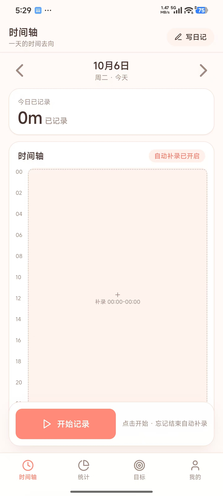
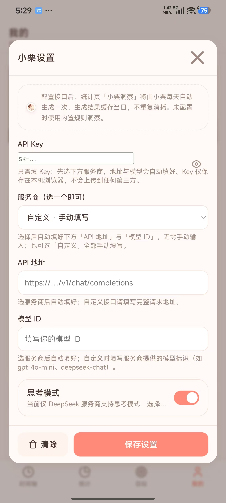

# 时间日记 (Time Diary)

二次元风格的时间记录应用（纯 HTML/CSS/JS SPA，hash 单页路由，零构建零依赖），奶油暖底 + 蜜桃珊瑚主色 + 樱花粉点缀，参考「爱时间」的信息架构 × 二次元轻量插画氛围。

## 效果图





## 功能

- 一键记录：开始 / 结束，忘记结束可随时补录（结束时间默认接续上一条记录）
- 时间轴：24 小时按分钟比例渲染，前后天切换，跨天记录按天裁剪
- 统计：今日 / 本周 / 本月环形占比图 + 时间账本 + 洞察
- 目标：时长型 / 次数型，每天 / 工作日 / 每周 / 仅一次，进度从记录实时推导
- 日记：一天一篇，心情标记，防抖自动保存，按日期自动关联当日时间记录
- 数据：导出 / 导入 JSON（带 schema 版本校验），主题浅色 / 深色切换

## 使用

直接用浏览器打开根目录 `index.html` 即可（单页应用，首次访问进入引导页），无需构建、无需安装依赖、无需联网（tailwind / lucide 已本地化到 `assets/vendor/`）。

- 路由为 hash 单页路由（`#/timeline`、`#/record-edit?id=...`），前进/后退动效方向相反，弹窗压历史（返回键先关弹窗）
- 手机端适配：安全区（刘海/Home Indicator）、键盘弹出隐藏底栏、横竖屏防抖重算
- 跑领域层测试（可选）：`node tests/run.js`

**接口与扩展点全览**（分层接口签名、存储 schema、扩展方式）：见 [docs/接口与扩展点.md](docs/接口与扩展点.md)

## 打包 Android APK

用 [Capacitor](https://capacitorjs.com) 把网页套成原生应用，工程在 `apk/`。工具链位置**可移植**：用 `-ToolsDir` 参数或环境变量 `TD_BUILD_TOOLS` 指定（未指定且默认路径 `F:\android-build-tools\` 不存在时，脚本会直接报错并提示配置方式），JDK 自动探测（也可 `-JdkPath` / `TD_JDK` 指定），不占用 C 盘。

```powershell
# 一次性准备（已完成则跳过）：
# 1) F:\android-build-tools\jdk-21.0.2        （OpenJDK 21，来自华为云镜像）
# 2) F:\android-build-tools\android-sdk       （cmdline-tools + platforms;android-35 + build-tools;35.0.0）
# 3) cd apk && npm install
# 4) cd apk && npx cap add android            （fresh clone 必需：仓库不含 android/ 目录，含签名配置）

# 一键打包（在 apk/ 目录）：
powershell -ExecutionPolicy Bypass -File tools\build-apk.ps1            # debug 包，直接可安装
powershell -ExecutionPolicy Bypass -File tools\build-apk.ps1 -Release   # release 包，首次自动生成签名 keystore
```

产物：`apk/TimeDiary-v版本-debug.apk` / `TimeDiary-v版本-release.apk`。改完网页代码后重新跑一次脚本即可（脚本会自动同步 `pages/css/js/assets` → `www/` → Android assets）。

手机安装：把 APK 传到手机点开安装（需允许"安装未知应用"）。数据存在应用本机，卸载前先在「我的 → 数据导出」备份。


## 目录结构（分层框架）

```
index.html        # SPA 单页入口（hash 路由壳）
css/tokens.css    # 样式层：设计令牌 + 公共组件 + 安全区 + 切换动效
js/
  config/         # 配置层：常量、默认分类模板、路由表
  utils/          # 工具层：id / 日期（本地时区）/ 格式化
  db/             # DB 层：存储适配器（localStorage 版，接口全异步）+ schema 迁移
  repo/           # Repository 层：业务数据访问接口（上层唯一入口）
  domain/         # 领域层：记录 / 目标 / 统计纯逻辑（不碰存储与 DOM）
  services/       # 服务层：通知（toast/confirm，弹窗压历史）、导入导出
  ui/             # UI 基础：组件（环形图/导航）、主题、视口（键盘/横竖屏）
  pages/          # 各页面：模板（TD.TPL）+ 初始化逻辑（TD.Pages）
  router.js       # hash 路由器：方向标记、动效编排、滚动恢复、首次 replace
  app.js          # 唯一入口：迁移 → 种子 → 主题 → 视口 → 路由启动
assets/vendor/    # 本地化的 tailwind / lucide
tests/            # 领域层测试（node 原生 assert）
```

## 数据模型（v1，schemaVersion=1）

| 实体 | 字段 |
|---|---|
| 分类 | id、名称、颜色、排序、归档标记（软删除）、创建时间 |
| 记录 | id、分类 id、开始/结束毫秒时间戳（end=null 表示进行中）、备注、创建/更新时间 |
| 目标 | id、分类 id、名称、类型（时长/次数）、目标分钟数/次数、周期、起止日期、提醒开关 |
| 日记 | id、dateKey（一天一篇）、标题、心情、正文、创建/更新时间 |
| 设置 | 主题、周起始日、onboarded |

规则：时间统一毫秒时间戳（本地时区）；主键 uuid；跨天记录存储原样、读取时按天裁剪；分类软删除、记录硬删除；迁移表已留（`js/db/migrations.js`），升级数据结构时在表中加幂等迁移函数并递增 `SCHEMA_VERSION`。

## 预留扩展点（只留位置，未实现）

- 换 IndexedDB：实现 `js/db/` 下新适配器即可，接口已全异步
- 分类拖拽排序、系统通知提醒、CSV 导出、PWA 离线缓存
